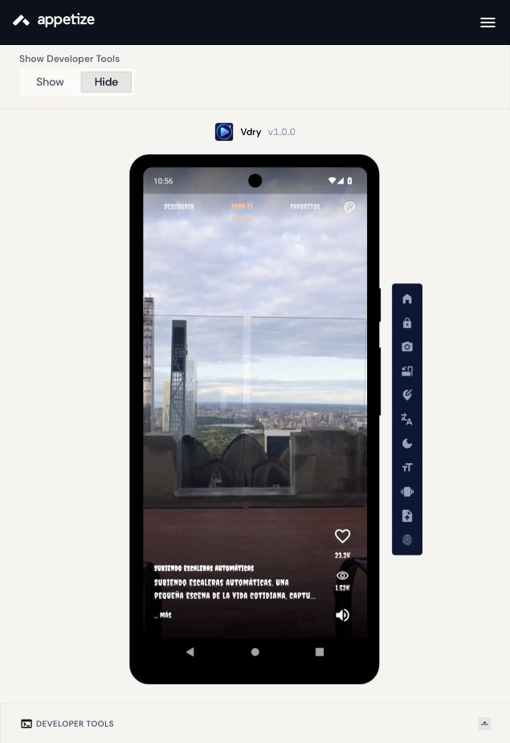
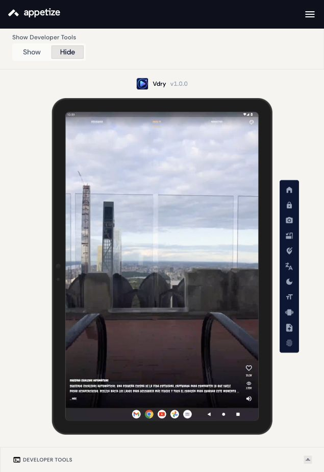
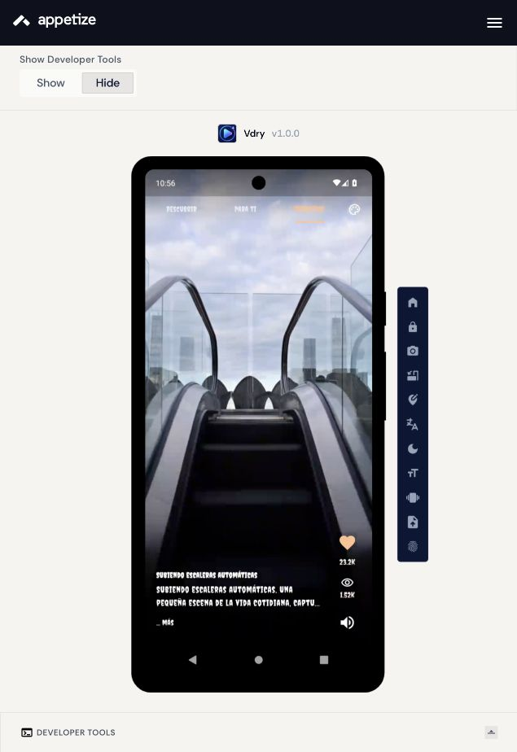
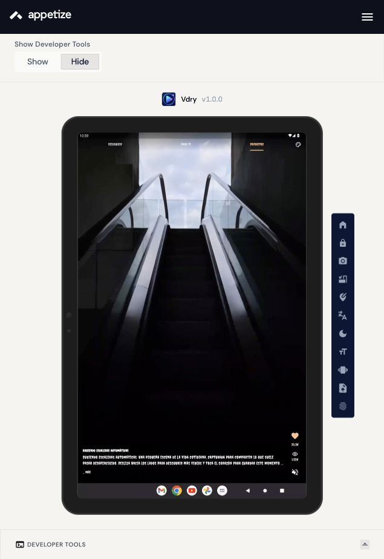
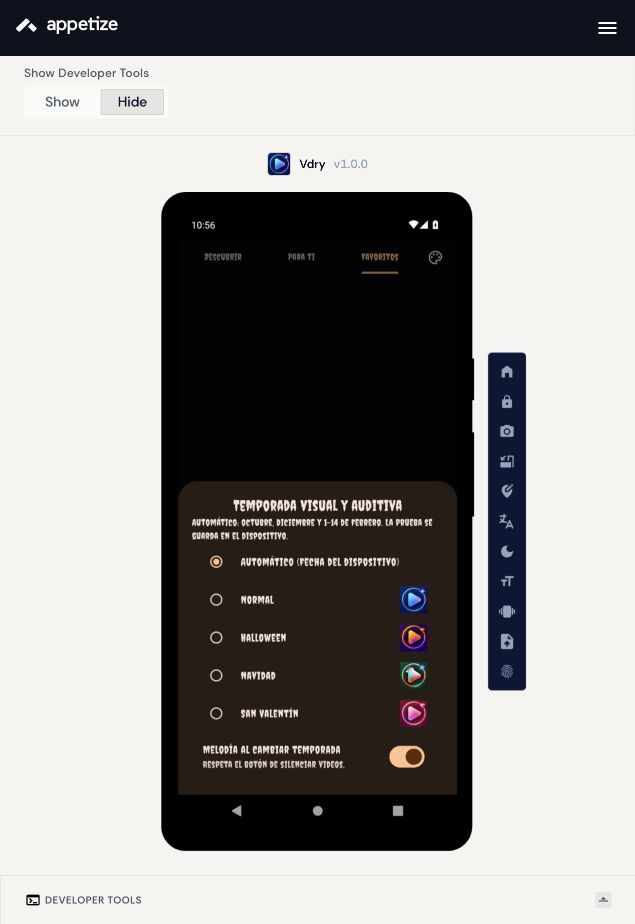
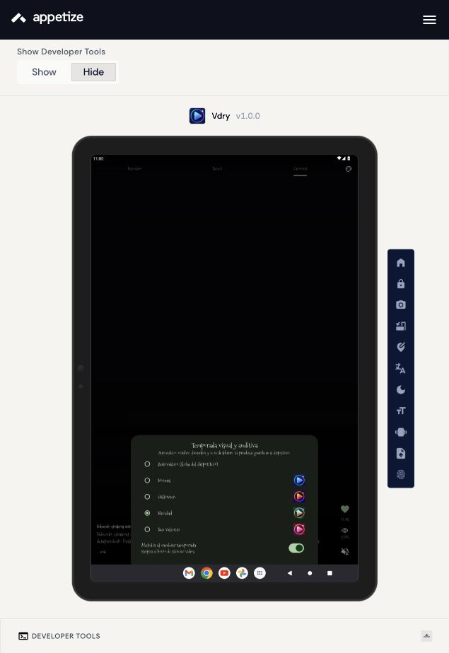

# Publicación de TokTik / Vdry en Appetize

**Alumno:** T.S.U. Adrián Pérez Jiménez

**Aplicación base:** [TokTik de Practica04](../toktik/).

**Fecha de preparación:** 13 de octubre de 2026.

## Objetivo y entrega

Compilar y publicar la aplicación de videos **Vdry**, cuyo proyecto Flutter se llama `toktik`, y validar navegación, videos locales/remotos, favoritos y temas en Android virtual. La investigación de Appetize ya realizada en la libreta no se repite aquí.

La copia de distribución se encuentra en `toktik/`. Los ejecutables se entregan en `apk/`, y los registros y capturas de las comprobaciones reales en `evidencias/`. Esta documentación sustituye la del contador: la app utilizada aquí es TokTik.

## Revisión del proyecto

- Identificador Android: `com.example.toktik`; nombre visible: **Vdry**.
- Versión: `1.0.0+1`.
- Flutter 3.47.6, Dart 3.13.5 y Java 17.
- Permiso `INTERNET` declarado en el manifiesto principal, necesario para las APIs, videos de red, fuentes y melodías de temporada.
- Catálogos: Descubrir (APIs), Para ti (13 videos locales), Favoritos (me gusta persistentes).
- APIs públicas sin credenciales: PeerTube / Sepia Search, Internet Archive y Wikimedia Commons.
- Orientación vertical fijada mediante `SystemChrome.setPreferredOrientations`.
- Conserva el launcher con aliases de temporada y su actividad de entrada estable.
- La configuración release firma con la llave debug local, como el proyecto original; el APK sirve para esta demostración académica.

### Recuperación del catálogo local

Al iniciar, `Practica04/toktik/assets/videos` no contenía los MP4. El APK de depuración existente en `Practica04/toktik/build/app/outputs/flutter-apk/app-debug.apk` conservaba tanto los originales como las variantes compatibles. Se recuperaron **los 13 videos completos de `assets/videos/playback/` del APK** y se colocaron en `Appetize/toktik/assets/videos/1.mp4` … `13.mp4`.

Son variantes generadas previamente para Android (hasta 720p y 30 fps), con el audio de sus respectivos videos. Se incluyen una sola vez en el APK de distribución para evitar duplicar originales y variantes. Conservan nombres e identidad de catálogo; el servicio de reproducción usa el archivo normal al no existir una segunda variante. La herramienta [preparar_videos.py](./preparar_videos.py) reproduce la recuperación desde las variantes de `../toktik/assets/videos/playback/`, si están presentes, o desde el APK de depuración anterior. También acepta `--apk /ruta/app-debug.apk` y permite comprobar los recursos con `--verificar`. Los MP4 son necesarios para volver a compilar; no se descargan automáticamente desde Git. Su origen, hashes y tamaños están en [recuperacion-videos.json](./evidencias/recuperacion-videos.json).

## Comandos y comprobaciones locales

Desde la raíz del repositorio:

```sh
cd Practica04/Appetize
python3 preparar_videos.py
cd toktik
flutter pub get
flutter analyze
flutter test --reporter expanded
flutter test test/public_api_live_check_test.dart --dart-define=VERIFY_PUBLIC_APIS=true --reporter expanded
flutter build apk --release
```

| Comprobación | Resultado |
| --- | --- |
| Análisis estático | Sin incidencias |
| Suite de unidad/widgets | 40 pruebas aprobadas; la prueba de red se omite en la suite normal |
| Prueba independiente de las tres APIs reales | Aprobada: PeerTube 2 videos, Archive 4, Wikimedia 2 |
| Catálogo real de assets | 13 videos detectados y ordenados |
| Likes, favoritos y preferencias | Pruebas aprobadas |
| Temas y límites de fechas | Pruebas aprobadas |
| Navegación lateral y cambio vertical de video | Pruebas aprobadas |
| Pausa, reanudación, mute y precarga | Pruebas aprobadas |

La prueba de APIs valida obtención de metadatos y enlaces, no demuestra por sí sola que todos los videos se reproduzcan en el emulador. Las pruebas de widgets usan reproductores simulados; la reproducción real se evalúa separadamente en Appetize.

Registros: [análisis](./evidencias/flutter-analyze.txt), [pruebas](./evidencias/flutter-test.txt), [APIs reales](./evidencias/public-api-live.txt) y [build release](./evidencias/flutter-build-release.txt).

## APK y firma

El comando genera `toktik/build/app/outputs/flutter-apk/app-release.apk`. Se entrega una copia como `apk/vdry-toktik-release.apk`. Tamaño: **326,063,566 bytes (326.06 MB)**. Incluye **13 MP4** y Flutter nativo para `armeabi-v7a`, `arm64-v8a` y `x86_64`. La firma se verificó con `apksigner verify --verbose`.

[APK release](./apk/vdry-toktik-release.apk) · [Metadatos](./apk/metadata.json) · [SHA-256](./apk/SHA256SUMS) · [Configuración Android del APK](./evidencias/apk-badging.txt) · [Verificación de firma](./evidencias/apk-firma.txt).

## Publicación y validación en Appetize

La cuenta se abrió desde [Upload](https://appetize.io/upload). El procedimiento es **Upload App → Select A File**, cargar el APK release, esperar **App uploaded**, abrir **Start** y obtener el enlace con **Share App**.

**Appetize procesó correctamente el APK de Vdry, versión 1.0.0.**

**Enlace compartible:** [Ejecutar TokTik / Vdry](https://appetize.io/app/b_iwtk5jwhmh6nti6syvn43pq5s4).

[Captura de publicación](./evidencias/appetize-publicada.jpg) · [Enlace generado por Share App](./evidencias/appetize-enlace.jpg).

### Resultados reales en Appetize

| Función / configuración | Pixel 7, Android 13 | Pixel Tablet, Android 13 |
| --- | --- | --- |
| Inicio y tres pestañas | Correcto | Correcto |
| Descubrir: video remoto | Reproducción observada, cascada de PeerTube | Reproducción observada, video de Internet Archive |
| Para ti: primer y segundo video local | Reproducción observada | Reproducción observada |
| Toque para pausa y reanudación | Correcto, indicador de reproducción visible | Correcto, indicador de reproducción visible |
| Like y navegación a Favoritos | Video guardado y visible | Video guardado y visible |
| Mute | Icono cambia al estado silenciado | Icono cambia al estado silenciado |
| Temporadas | Tema Normal aplicado | Navidad aplicada; retorno a automático/Halloween |
| Desplazamiento vertical | Cambia del primer al segundo video | Cambia del primer al segundo video |
| Descripción expandible | Texto completo visible al pulsar más | No comprobada manualmente en tablet |
| Distribución de la interfaz | Sin recortes observados | Sin recortes observados; escala Auto del navegador reduce los textos en la captura |

Las capturas de videos en momentos distintos permitieron observar reproducción real. Se comprobó el cambio del control de mute; no se realizó una medición acústica. La persistencia después de matar y volver a abrir el proceso se validó mediante las pruebas automatizadas de preferencias, no mediante una prueba manual de reinicio del proceso en Appetize.

**Rotación:** se accionó Rotate en Pixel 7. El marco del emulador giró, pero la app conservó su interfaz vertical (`portraitUp`), presentada lateralmente dentro del marco. No se afirma soporte de un diseño horizontal.

**Enlace compartido:** el enlace obtenido de Share App se abrió en una pestaña nueva y se inició una sesión independiente de emulación con Pixel Tablet. La cuenta del navegador permaneció autenticada; no se verificó acceso desde un navegador sin sesión.

### Capturas

| Pixel 7 / Android 13 | Pixel Tablet / Android 13 |
| --- | --- |
|  |  |
|  |  |
|  |  |

[Video remoto en teléfono](./evidencias/pixel7-descubrir.jpg) · [Video remoto en tablet](./evidencias/tablet-descubrir.jpg) · [Pausa](./evidencias/pixel7-pausa.jpg) · [Descripción expandida](./evidencias/pixel7-descripcion.jpg) · [Rotación](./evidencias/pixel7-rotacion.jpg).

### Ventajas y limitaciones observadas

Appetize permitió ejecutar el APK con videos locales y APIs desde el navegador y comparar un teléfono con una tablet. La carga de este APK grande tomó aproximadamente 42 minutos en esta conexión; conservar una sola variante por video evita aumentar aún más el paquete. Las APIs y los videos remotos dependen de servicios externos y pueden variar entre sesiones. Los tiempos de arranque y la fidelidad del audio no se midieron formalmente. La prueba no sustituye una validación de rendimiento en hardware físico.

No se reutilizan las capturas ni el enlace del contador de Practica02.

Procedimiento de las pruebas:

1. Iniciar el APK y verificar las tres pestañas y el selector de tema.
2. Abrir Para ti, reproducir un video local, pausarlo/reanudarlo y avanzar con gesto vertical.
3. Marcar un corazón y verificar el video en Favoritos.
4. Probar mute, selector de temporadas y retorno al modo automático.
5. Abrir Descubrir y verificar contenido remoto o documentar el error del proveedor.
6. Comparar legibilidad y distribución en dos configuraciones Android, probar la rotación y registrar el comportamiento de la orientación vertical.
7. Comprobar el enlace en una sesión de ejecución independiente.

## Incidencias

| Incidencia | Tratamiento |
| --- | --- |
| Faltaban MP4 en la carpeta de assets al comenzar | Se recuperaron los 13 videos compatibles del APK anterior; la prueba del bundle real pasó |
| Tamaño de los originales y sus variantes duplicadas | Se incorporó una sola copia compatible de cada video |
| Advertencia de versiones XML del SDK Android | Advertencia no bloqueante: el APK release se generó y Appetize lo procesó correctamente |

## Recursos y control de versiones

El APK y los videos se excluyen del seguimiento normal mediante `.gitignore` para no subir binarios grandes al repositorio. Permanecen disponibles localmente y el APK se distribuye desde Appetize. La configuración, código, metadatos, documentación y capturas pueden registrarse en Git.

No se publican llaves de firma, rutas de SDK locales ni archivos personales de credenciales. Al comenzar ya existían cambios del usuario en Practica05; la documentación y archivos nuevos de esta tarea están dentro de Practica04.

## Guion de demostración

Mostrar el APK y su versión, abrir el enlace de Vdry en Appetize, reproducir un video en Para ti, guardar un favorito, cambiar de tema y mostrar Descubrir. Comparar las capturas del teléfono y la tablet y explicar que las APIs y la emulación dependen de la red y de la disponibilidad del servicio.

Referencias del procedimiento: [carga de APK Android](https://docs.appetize.io/platform/app-management/uploading-apps/android) y [enlaces compartibles](https://docs.appetize.io/platform/sharing-apps).
