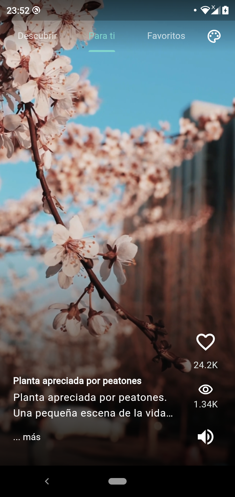
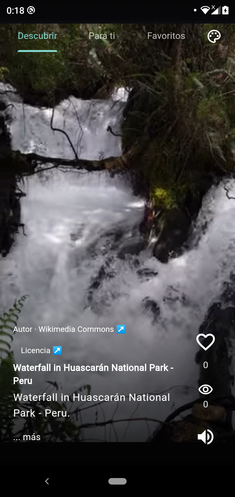
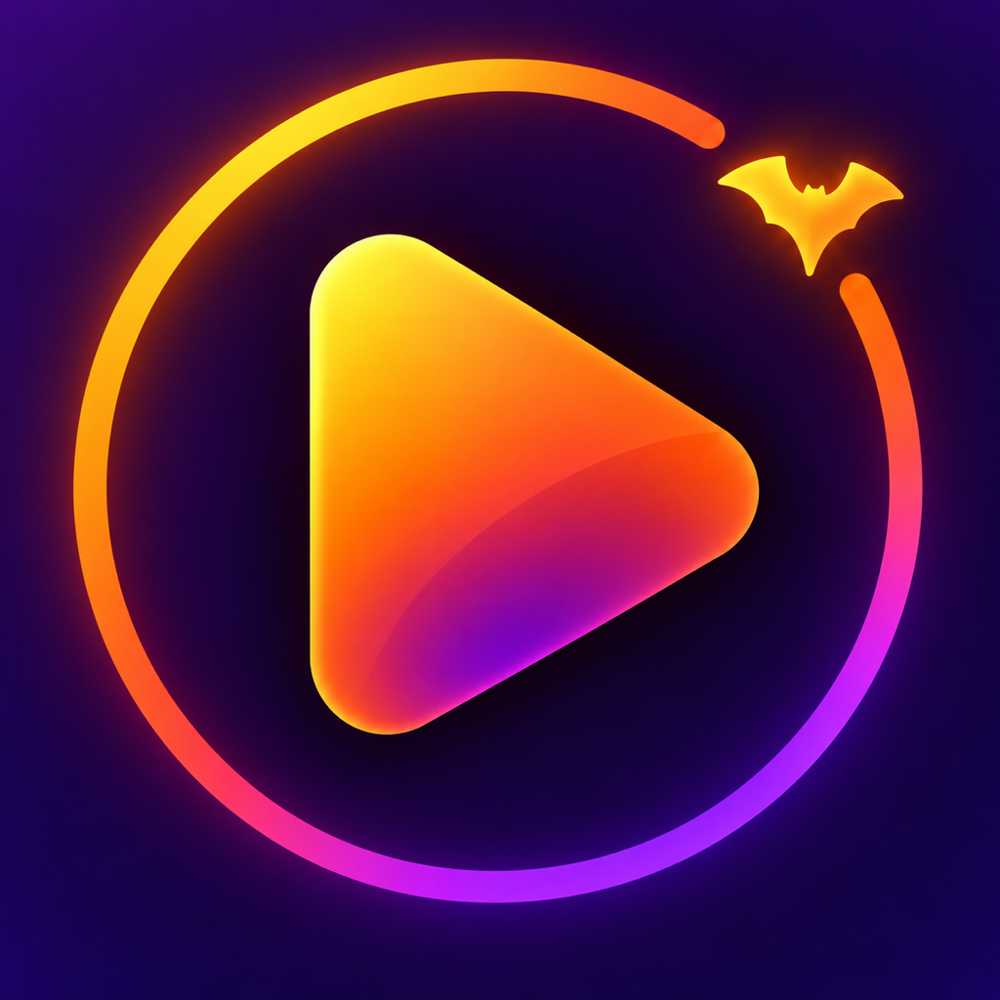
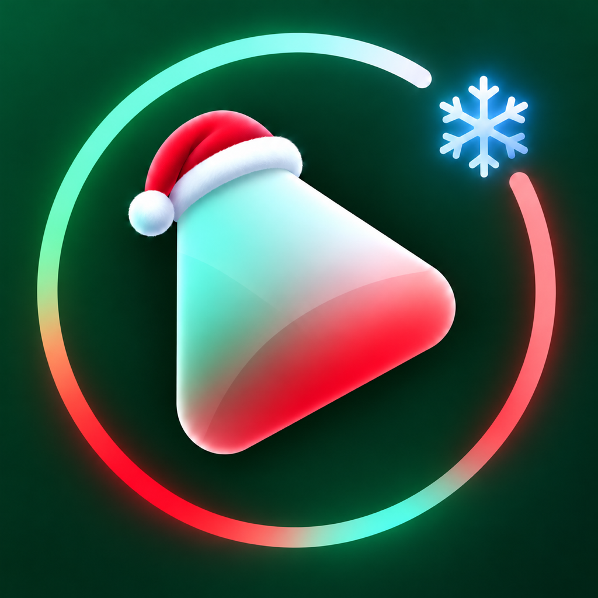

# Práctica 4: Vdry — Aplicación de Videos Cortos con Temas por Temporada

## Descripción

Desarrollo y ampliación de una aplicación móvil en **Flutter** y **Dart** para visualizar videos cortos mediante una interfaz inspirada en **TikTok**. La aplicación se presenta al usuario como **Vdry**, mientras que el proyecto conserva el nombre interno **`toktik`** para mantener la configuración del paquete y la compatibilidad con los datos existentes.

La aplicación integra las secciones **Descubrir**, **Para ti** y **Favoritos**, reproducción de videos locales y remotos, controles de pausa y sonido, descripciones expandibles y almacenamiento persistente de preferencias y me gusta. Además, adapta su apariencia a las temporadas **Normal**, **Halloween**, **Navidad** y **San Valentín**, incluyendo tipografías, colores, iconografía, melodías e iconos de la aplicación.

La lógica de la aplicación se organiza principalmente dentro de **`toktik/lib`**, separando el dominio, la infraestructura y la presentación mediante contratos, repositorios, datasources y componentes reutilizables. Los recursos, las pruebas y las configuraciones nativas permanecen en las carpetas correspondientes del proyecto Flutter.

## Objetivo

Desarrollar una aplicación móvil de videos cortos que combine reproducción multimedia, consumo de **tres APIs públicas**, personalización automática por fecha y persistencia local, manteniendo una organización basada en **Clean Architecture** y principios de **Clean Code**. Implementar una navegación fluida, conservar el diseño original del feed y mejorar la compatibilidad y el rendimiento en dispositivos Android.

## Actividades

- **Revisión y Organización del Proyecto:** Se revisó la estructura inicial y se organizaron las responsabilidades en `domain`, `infrastructure`, `presentation`, `config` y `shared`. Las entidades y los contratos del dominio se separaron de la obtención de datos, el almacenamiento y los widgets de Flutter.

- **Conservación del Diseño de la Interfaz:** Se mantuvo el video como elemento principal de la pantalla, con texto superpuesto y una columna inferior derecha para las acciones. La parte superior contiene una sola fila con **Descubrir**, **Para ti**, **Favoritos** y el botón de temas. Se conservó la interfaz sin una barra adicional con el logo o el nombre de la aplicación.

- **Navegación entre Secciones:** Se implementó el cambio de sección mediante pestañas y desplazamiento lateral. Dentro de cada feed, el desplazamiento vertical permite pasar de un video a otro. La selección de una sección determina qué repositorio proporciona los videos.

- **Separación de los Catálogos:** **Para ti** muestra exclusivamente los videos locales, **Descubrir** obtiene videos de las tres APIs y **Favoritos** reúne los videos marcados con un corazón de cualquiera de las dos secciones. El catálogo local puede consultarse sin esperar a los servicios externos.

- **Integración de los 13 Videos Locales:** Se incorporaron los **13 archivos MP4** de `assets/videos`, ordenados numéricamente. El datasource consulta el manifiesto de recursos de Flutter y combina los archivos disponibles con sus metadatos. Las copias de reproducción de la subcarpeta `playback` no aparecen como videos adicionales en el feed.

- **Consumo de Tres APIs Independientes:** Se integraron **PeerTube mediante Sepia Search**, **Internet Archive** y **Wikimedia Commons**, cada una con su propio datasource y acceso mediante repositorios. Las fuentes actuales no requieren API keys, cuentas ni credenciales inventadas. Se utilizan enlaces directos de reproducción, sin incrustar las interfaces o los botones de plataformas externas.

- **Selección de Contenido Remoto:** Se filtraron videos verticales, cortos y con audio original, orientados a naturaleza, cascadas, playas, bosques y paisajes. Se incorporaron la descripción, la procedencia y los enlaces de autor y licencia. Los videos remotos conservan su encuadre completo durante la reproducción.

- **Paginación y Carga Progresiva:** Se implementó la continuación de los catálogos mediante los cursores o páginas de cada API, sin un límite fijo de seis videos. Descubrir muestra resultados conforme responde cada fuente, permitiendo presentar contenido disponible mientras los otros servicios siguen trabajando.

- **Reproducción, Pausa y Ciclo de Vida:** Se utilizó `video_player` para reproducir los recursos locales y los videos de red. Tocar el video permite pausarlo o reanudarlo. La reproducción se pausa cuando la app pasa al segundo plano, y los reproductores que dejan de utilizarse liberan sus recursos.

- **Control de Sonido:** Se agregó un botón de volumen a la columna de acciones para silenciar o activar el audio. La preferencia se guarda en el dispositivo. Se corrigió la interacción entre el mute y la melodía de temporada: cambiar el volumen no dispara nuevamente el sonido del tema ni modifica la pausa elegida por el usuario.

- **Persistencia de Me Gusta y Favoritos:** Al marcar el corazón se suma un me gusta y se agrega el video a Favoritos; al desmarcarlo se resta uno y se retira de esa sección. Se guardan el contador, el estado y los metadatos del video mediante **SharedPreferences**. Las escrituras se serializan para conservar cambios rápidos y evitar inconsistencias.

- **Descripciones Extensas:** Se implementó una descripción inicialmente limitada a **dos líneas**. Cuando el texto requiere más espacio, el botón **«… más»** permite expandirlo en una región con desplazamiento vertical independiente del feed. El botón **«menos»** vuelve a contraer la descripción.

- **Temas Visuales por Fecha:** Se implementó la selección automática del tema mediante la fecha local del dispositivo. Cada temporada modifica la tipografía, el color principal y la iconografía. La fecha se revisa al regresar a la aplicación y periódicamente mientras permanece abierta.

- **Modo de Prueba de Temporadas:** Se agregó un selector accesible desde el botón de paleta. Permite forzar cualquier temporada y guardar esa elección localmente para comprobar el diseño sin cambiar la fecha del teléfono. La opción **Automático** vuelve a aplicar las reglas del calendario.

- **Tematización Auditiva:** Se generaron melodías breves en memoria para acompañar el inicio o cambio de temporada cuando el sonido y la opción de melodía están habilitados. Se configuró su reproducción para mezclar audio sin quitar el foco al video. Las melodías no se añaden a los archivos de video ni se repiten al quitar el mute.

- **Iconos y Splash por Temporada:** Se prepararon los iconos de Normal, Halloween, Navidad y San Valentín, con lienzos cuadrados de **1024 × 1024** y proporciones consistentes. En Android se configuraron recursos adaptativos y aliases del launcher, manteniendo una actividad estable para evitar errores de arranque al cambiar de icono. El splash utiliza la temporada guardada o calculada por fecha. También se configuraron iconos alternativos para iOS y favicon por temporada en web.

- **Compatibilidad con el Nokia 5.1 Plus:** Se conservaron los videos originales y se generaron variantes **H.264 a 720p y 30 fps** para facilitar su reproducción. Se implementó un ajuste nativo específico para el Nokia con Android 10, utilizando la ruta de textura OpenGLES/Skia para resolver el problema de buffers del decodificador observado en ese dispositivo.

- **Optimización de Videos Remotos:** Se priorizaron rendiciones ligeras, playlists HLS de PeerTube y variantes de Wikimedia cercanas a 480 píxeles de altura. Internet Archive descarta archivos con bitrate medio superior a **4 Mbps**. Se añadió una precarga en memoria limitada al video actual y al siguiente, reutilizando el controlador preparado al avanzar y sin reproducir audio del video siguiente.

- **Verificación de Funcionalidades:** Se incorporaron pruebas de reglas de temporada, persistencia, favoritos, sonido, descripciones, navegación, paginación, carga progresiva y gestión de reproductores. La última verificación de la implementación completó **40 pruebas automatizadas**, además de consultas reales a las tres APIs y comprobaciones de la aplicación instalada en el Nokia.

## Temas Implementados

| Tema | Selección automática | Tipografía | Color principal | Iconografía |
| --- | --- | --- | --- | --- |
| **Normal** | Fechas fuera de las temporadas especiales | Roboto | Turquesa | Nota musical |
| **Halloween** | Todo octubre | Creepster | Naranja | Luna |
| **Navidad** | Todo diciembre | Mountains of Christmas | Verde | Copo de nieve |
| **San Valentín** | Del 1 al 14 de febrero | Dancing Script | Rosa | Corazón |

La temporada forzada desde el selector tiene prioridad sobre la fecha y se conserva al cerrar la aplicación. Los iconos del sistema se sincronizan cuando la app se ejecuta; no se implementó un cambio del launcher en segundo plano mientras la aplicación permanece cerrada.

## APIs y Repositorios

| Fuente | Obtención de datos | Reproducción y selección |
| --- | --- | --- |
| **PeerTube / Sepia Search** | Búsqueda pública en Sepia Search y consulta del detalle en la instancia que publica el video | Rendiciones con audio y video; preferencia por calidad ligera y playlist HLS cuando está disponible |
| **Internet Archive** | API de metadatos y búsqueda avanzada de archivos públicos | MP4 verticales ligeros; verificación de la pista de audio mediante lectura parcial de las cabeceras del archivo |
| **Wikimedia Commons** | API de MediaWiki con búsqueda e información de videos | Variantes WebM con audio en Android/web y QuickTime en plataformas Apple |

**`VideoPostDatasource`** define el contrato de las fuentes y **`VideoPostsRepositoryImpl`** permite utilizarlas sin acoplar la presentación a una API concreta. Los repositorios de feeds determinan el catálogo de cada sección; **`LocalPreferencesRepository`** administra las preferencias y favoritos persistentes. La composición e inyección de las implementaciones se realiza en `main.dart`.

Los metadatos HTTP se conservan durante **24 horas** en el almacenamiento local. Los archivos remotos se reproducen por red; la precarga del reproductor es temporal y no constituye una caché persistente de videos completos.

La información de endpoints y acceso para explicar el consumo de APIs se encuentra en [APIs públicas y credenciales](./toktik/API_CREDENTIALS.md).

---

## Resultados

Se obtuvo una aplicación que permite reproducir los 13 videos locales en **Para ti**, descubrir contenido de tres fuentes remotas, guardar favoritos y personalizar su apariencia por temporada. Se conservaron el nombre visible **Vdry**, el diseño del feed y la independencia entre los catálogos locales y de red.

Las siguientes capturas reales muestran la aplicación en ejecución en el **Nokia 5.1 Plus**, junto con el icono base utilizado para el tema Normal:

| Para ti — Videos locales | Descubrir — Video de una API | Icono de Vdry — Tema Normal |
| :---: | :---: | :---: |
|  |  |  |

### Iconos por Temporada

| Normal | Halloween | Navidad | San Valentín |
| :---: | :---: | :---: | :---: |
|  |  |  |  |

### Persistencia y Sonido

Los me gusta, favoritos, mute y elección de temporada se conservan al cerrar y volver a abrir la app, mientras no se borren sus datos de almacenamiento. Los likes son **locales al dispositivo** y no se envían a las plataformas externas.

Se respetó el audio original de los videos locales: **`1.mp4`, `2.mp4`, `9.mp4` y `10.mp4`** tienen pista de sonido; los otros nueve permanecen silenciosos. No se agregó música de fondo a esos archivos. Las melodías de temporada se administran de forma separada y pueden deshabilitarse.

### Alcance de la Verificación

La reproducción y los ajustes de compatibilidad se comprobaron en Android, utilizando el Nokia. La configuración de iOS está incluida en el proyecto, pero no se realizó una compilación ni una prueba en un dispositivo iOS durante esta práctica.

Los videos remotos dependen de la disponibilidad y velocidad de los servidores públicos. En las pruebas se observó una respuesta **HTTP 429** por limitación de solicitudes de un servidor; las versiones ligeras y la precarga reducen la espera de la app, pero no eliminan las restricciones del proveedor.

<a name="arquitectura"></a>

## Diagramas y Estructura del Proyecto

La práctica incluye **dos diagramas de arquitectura**, organizados en sus carpetas correspondientes:

| Sección | Enlace para GitHub Pages |
| --- | --- |
| **Sección 7** | [Abrir sección 7](https://heidrihen52.github.io/Practicas_DMI_230052/Practica04/architecture/seccion7/) |
| **Sección 8** | [Abrir sección 8](https://heidrihen52.github.io/Practicas_DMI_230052/Practica04/architecture/seccion8/) |

Los diagramas documentan la organización trabajada en las **secciones 7 y 8**. La estructura y las actividades descritas en este README incluyen también las ampliaciones finales de temporadas, persistencia, feeds, APIs y precarga; los diagramas conservan la documentación de sus respectivas secciones.

```text
Practica04/
├── README.md
├── architecture/
│   ├── seccion7/
│   │   └── index.html
│   └── seccion8/
│       └── index.html
├── results/
│   ├── cap1.png
│   └── cap2.png
└── toktik/
    ├── lib/
    │   ├── config/          # Temas, iconos de temporada y formato de cifras
    │   ├── domain/          # Entidades, reglas y contratos de repositorios/servicios
    │   ├── infrastructure/  # Datasources, repositorios y servicios concretos
    │   ├── presentation/    # Providers, pantallas y widgets de reproducción
    │   ├── shared/          # Metadatos del catálogo local
    │   └── main.dart        # Inicio, composición e inyección de dependencias
    ├── assets/
    │   ├── icons/           # Iconos de las cuatro temporadas
    │   └── videos/
    │       ├── 1.mp4 … 13.mp4
    │       └── playback/    # Variantes compatibles de los videos originales
    ├── android/             # Configuración nativa de launcher, splash y compatibilidad
    ├── ios/                 # Configuración de iconos alternativos y arranque
    ├── test/                # Pruebas automatizadas
    ├── tool/                # Herramienta para generar variantes de reproducción
    ├── API_CREDENTIALS.md
    └── pubspec.yaml
```

La documentación técnica complementaria de la implementación está disponible en [Funciones y arquitectura de Vdry](./toktik/lib/README.md).

## Ejecución y Verificación

Desde la carpeta `Practica04`, ingresar al proyecto y ejecutar:

```sh
cd toktik
flutter pub get
flutter run
```

Para analizar el código, ejecutar las pruebas y generar una APK de depuración:

```sh
flutter analyze
flutter test
flutter build apk --debug
```

La comprobación opcional contra las **tres APIs reales**, con acceso a internet, se ejecuta mediante:

```sh
flutter test test/public_api_live_check_test.dart --dart-define=VERIFY_PUBLIC_APIS=true
```

No se requiere un archivo de claves para ejecutar la aplicación. Los cambios en recursos nativos, iconos o splash necesitan recompilar e instalar la app; hot reload permite revisar cambios de Dart, pero no incorpora esas configuraciones nativas.
