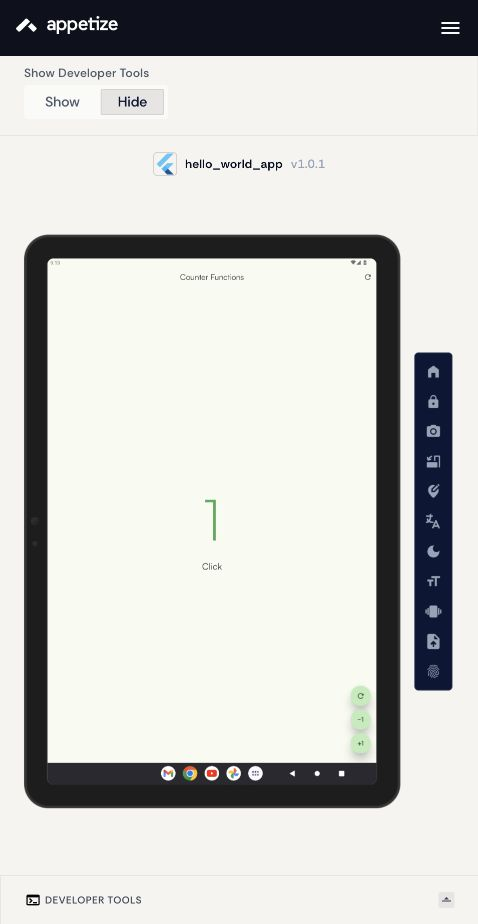
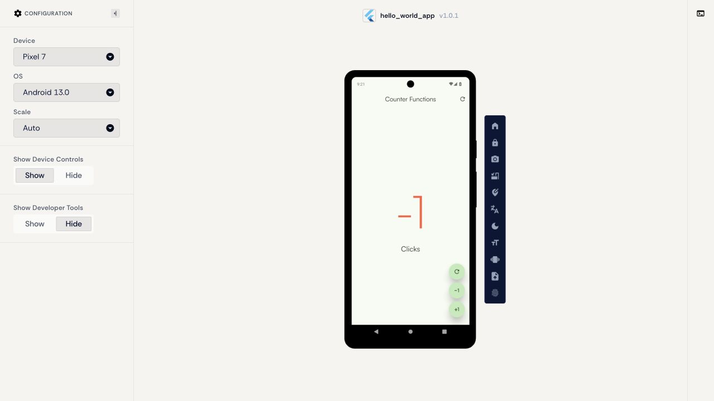
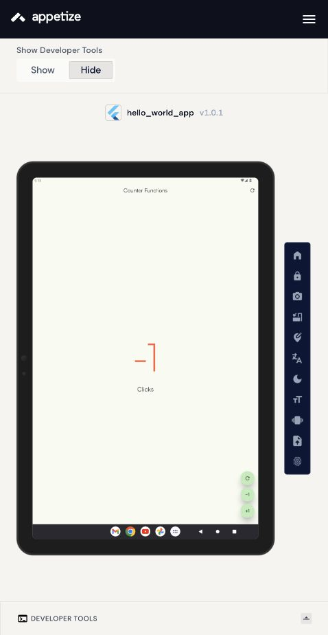

# Práctica 05: Publicación de la app en Appetize

**Alumno:** T.S.U. Adrián Pérez Jiménez
**Aplicación base:** contador de [Práctica 02](../Practica02/)
**Fecha:** 12 de octubre de 2026

## Objetivo

Compilar el contador Flutter como APK release, publicarlo en Appetize y validar su funcionamiento en dispositivos Android virtuales. La investigación de la actividad 1 se realizó en la libreta y no se reproduce aquí.

## Proyecto y preparación

La copia utilizada para esta práctica está en `hello_world_app/`, con el código Dart, fuentes Satoshi, configuración Android y dependencias bloqueadas en `pubspec.lock`. Practica02 conserva su proyecto original. Se incluyó la plataforma Android necesaria para el APK.

- Aplicación: `hello_world_app`.
- Identificador Android: `com.example.hello_world_app`.
- Versión: `1.0.1+2`.
- Flutter: 3.47.6; Dart: 3.13.5; Java: OpenJDK 17.
- Pantalla inicial: `Counter Functions`, contador en cero y color azul.
- Funciones: incrementar, decrementar y restablecer desde dos botones; colores verde, rojo y azul según el valor, y etiqueta singular/plural.
- La app no implementa llamadas API, formularios, listas desplazables ni navegación entre pantallas. Esas pruebas no aplican a esta versión.
- El manifiesto principal no solicita permisos peligrosos ni acceso a Internet. Las fuentes se incluyen localmente.
- El build release usa la firma de depuración configurada en el proyecto original. Es una compilación académica para Appetize; no corresponde a una distribución firmada para Google Play.
- Las cachés, rutas locales, llaves de firma y productos intermedios se excluyen mediante `.gitignore`.

## Compilación y validación local

Desde la raíz del repositorio:

```sh
cd Practica05/hello_world_app
flutter pub get
flutter analyze
flutter test --reporter expanded
flutter build apk --release
```

El APK se genera en `hello_world_app/build/app/outputs/flutter-apk/app-release.apk` y se entrega en [apk/contador-practica02-release.apk](./apk/contador-practica02-release.apk).

Tamaño: **44,196,486 bytes (44.20 MB / 42.15 MiB)**. SDK mínimo: **24 (Android 7)**; SDK objetivo: **36**. Incluye `armeabi-v7a`, `arm64-v8a` y `x86_64`. La firma v2 fue validada con `apksigner verify --verbose`; sus metadatos, tamaño y SHA-256 se guardan en [metadata.json](./apk/metadata.json) y [SHA256SUMS](./apk/SHA256SUMS). Los registros reales están en [evidencias](./evidencias/).

| Prueba local automatizada | Resultado |
| --- | --- |
| Inicio en 0 y color azul | Aprobada |
| Incremento a 1, color verde y etiqueta Click | Aprobada |
| Decremento a -1, color rojo y etiqueta Clicks | Aprobada |
| Reinicio desde botón flotante y barra superior | Aprobada |
| Distribución e interacción a 360×640 | Aprobada |
| Distribución e interacción a 412×915 | Aprobada |
| Distribución e interacción horizontal a 640×360 | Aprobada |
| Análisis estático | Sin incidencias |

Estas comprobaciones usan el entorno de pruebas de widgets de Flutter. Las configuraciones de tamaño son lógicas; no equivalen a ejecutar el APK en Appetize.

## Incidencias y correcciones

| Incidencia | Corrección / evaluación |
| --- | --- |
| La prueba heredada buscaba `Icons.add`, pero el botón real usa `Icons.plus_one` | Se reemplazó con pruebas de las acciones reales, colores y ambas opciones de reinicio |
| Importación sin uso y construcción de MyApp sin const | Se retiró la importación y se usó `const MyApp()`; análisis sin incidencias |
| Advertencia de versiones de XML del SDK Android durante la compilación | Advertencia no bloqueante: `assembleRelease` terminó correctamente y el APK fue procesado por Appetize |

## Publicación y pruebas en Appetize

El APK Android se carga desde [Upload](https://appetize.io/upload), usando **Upload App → Select A File**. Después del procesamiento se abre el build y se obtiene su enlace con **Share**.

**Enlace del build final 1.0.1:** [Ejecutar contador en Appetize](https://appetize.io/app/b_j6zv4n7hxxa5h4y2jenkj3s5qy).

La carga inicial fue procesada correctamente. Se publicó después la versión 1.0.1 para evaluar el uso de Skia (`io.flutter.embedding.android.EnableImpeller=false`).

### Incidencia del emulador Nexus 5 / Android 11

El contador se cerró al iniciar. Los logs muestran un emulador **x86 de 32 bits** que carga las bibliotecas ARM mediante `ndk_translation`, seguido de errores EGL y `SIGSEGV` en el hilo `1.raster`. Se intentó usar Skia; la versión 1.0.1 tampoco abrió en esa configuración. **La incidencia no se considera resuelta en Nexus 5.** La causa probable es la compatibilidad del motor nativo con la traducción ARM del emulador; es una inferencia, no un diagnóstico definitivo.

Flutter AOT ofrece `armeabi-v7a`, `arm64-v8a` y `x86_64`, no x86 de 32 bits: [documentación de arquitecturas](https://docs.flutter.dev/add-to-app/android/project-setup). Por ello, las pruebas válidas para la demostración se realizan con configuraciones Android 13 compatibles. Se conservaron [logs del cierre inicial](./evidencias/nexus5-android11-error.txt) y [captura de la versión 1.0.1 en Nexus](./evidencias/nexus5-android11-version101.jpg). El ajuste de renderer sigue la [configuración oficial de Impeller](https://docs.flutter.dev/perf/impeller).

### Resultados del build final 1.0.1

| Configuración de Appetize | Inicio e interfaz | Incremento / decremento | Ambos reinicios | Resultado |
| --- | --- | --- | --- | --- |
| Pixel 7 / Android 13 / vertical | Correctos; cero azul y fuentes locales | 1 verde / -1 rojo y singular-plural correctos | Correctos | Aprobada |
| Pixel Tablet / Android 13 / vertical | Correctos; elementos visibles y centrados | 1 verde / -1 rojo y singular-plural correctos | Correctos | Aprobada |
| Nexus 5 / Android 11 / vertical | Cierre al iniciar; launcher de Android visible | No se pudieron probar | No se pudieron probar | Incidencia pendiente de compatibilidad |

No se observaron desbordamientos ni recortes en las dos configuraciones aprobadas con los valores probados. La orientación horizontal se verificó en Pixel 7 tanto con el build inicial 1.0.0 como con el final 1.0.1; el contador y sus botones permanecieron visibles y el incremento respondió.

La primera ejecución en Pixel 7 estuvo visible antes de la comprobación realizada unos 20 segundos después de iniciar; ese dato es un límite de observación, no una medición exacta de arranque. No se realizó un benchmark.

Se cerró la sesión de cuenta y se abrió el enlace del build en otra pestaña. El APK final inició en Pixel 7 y respondió a sus acciones **sin iniciar sesión en Appetize**, verificando el acceso para el docente.

### Evidencias visuales

| Teléfono: Pixel 7, Android 13, build 1.0.1 | Tablet: Pixel Tablet, Android 13, build 1.0.1 |
| --- | --- |
|  |  |
|  |  |

[Configuración completa de tablet](./evidencias/tablet-android13-configuracion.jpg) · [Enlace generado por Share](./evidencias/appetize-enlace.jpg) · [Orientación horizontal, build final](./evidencias/pixel7-version101-publico-horizontal.jpg).

### Ventajas y limitaciones observadas

El docente puede ejecutar el APK desde el enlace sin instalarlo en un teléfono. El cambio de configuración permite comparar teléfono y tablet. La sesión necesita conexión a Internet y puede requerir reinicio al cambiar opciones. El entorno de nube no sustituye pruebas físicas: se detectó una incompatibilidad del emulador antiguo, y estas pruebas no cubren sensores, rendimiento sostenido ni todas las versiones Android. El panel de la cuenta mostró que los embeds requieren otro plan; la entrega usa el enlace de ejecución.

Referencias técnicas del procedimiento: [carga Android](https://docs.appetize.io/platform/app-management/uploading-apps/android) y [compartir builds](https://docs.appetize.io/platform/sharing-apps).

## Control de versiones

La rama de trabajo existente al comenzar fue `Practica05`, creada desde `main`. Se conservó ese nombre y se registraron el APK, fuente, documentación y capturas. Se integró mediante un merge explícito (`--no-ff`), como en las prácticas anteriores del repositorio.

```sh
git add README.md Practica05
git commit -m "Practica05: publicar contador Flutter en Appetize y documentar pruebas"
git switch main
git merge --no-ff Practica05 -m "Integrar Practica05: publicacion y pruebas en Appetize"
git push origin Practica05 main
```

[Ver rama de trabajo en GitHub](https://github.com/heidrihen52/Practicas_DMI_230052/tree/Practica05/Practica05) · [Ver historial de integración](https://github.com/heidrihen52/Practicas_DMI_230052/commits/main/). Los hashes concretos se registran en [evidencia de integración](./evidencias/git-integracion.txt).
[Ver demo en Appetize](https://appetize.io/app/b_j6zv4n7hxxa5h4y2jenkj3s5qy).

